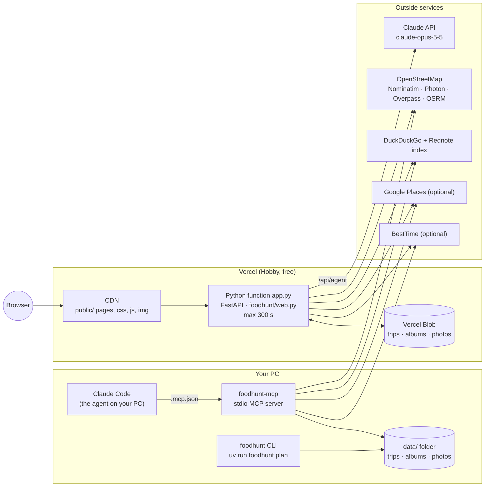
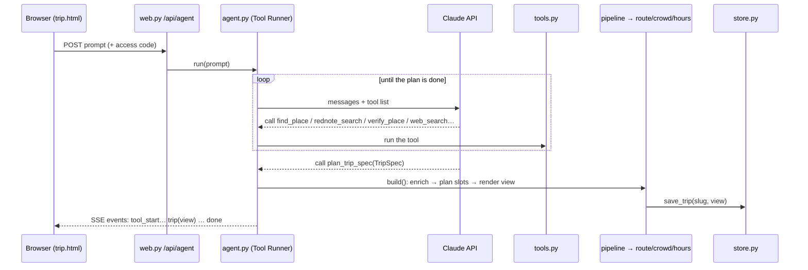

# Food Hunt

Turns "places people rave about on Rednote/Google" into a **verified, time-aware, walkable food
route**. Then your trip photos become an **album** with "Proust symbols".

- **Live:** <https://food-hunting.vercel.app>
- **Code:** <https://github.com/TanWaiKen/food-hunting>
- **Other docs:**
  - Process: [docs/WORKFLOW.md](docs/WORKFLOW.md) (AI-DLC Lite)
  - Every decision, with Why/How/Result: [docs/DECISIONS.md](docs/DECISIONS.md)
  - Look and feel: [DESIGN.md](DESIGN.md) (§12 Poster is the current style)

All times on the site are **Kuala Lumpur time (MYT)**. Each trip plans in its own local time
(`timezone:` in the trip file), and the local time is shown underneath.

---

## 1. Infrastructure at a glance



There are **one codebase and three ways in**. They all call the same tool functions in `foodhunt/tools.py`:

| Way in | Who is the agent | Where data is saved | Costs |
|---|---|---|---|
| Claude Code on your PC (`/food-hunt`, the MCP tools) | Claude Code itself | `data/` on disk | your Claude Code plan |
| Website on Vercel, "Plan a trip" | `foodhunt/agent.py` (Claude API Tool Runner) | Vercel Blob | `ANTHROPIC_API_KEY`, pay per use |
| Remote MCP `https://…/mcp/` from any MCP client | that client | Vercel Blob | free (no LLM on our side) |

The planner itself (`route.py`, `crowd.py`, `hours.py`) is **plain code, with no AI**. Give it the same input and you get the same route.

---

## 2. What happens on a request

### Planning a trip (website)


### Adding photos (route card or album page)
1. The browser sends `POST /api/trips/{slug}/photos` with the files and, from a restaurant card, a `stop_key`.
2. `photos.add_photo` then processes each photo:
   1. It turns the photo upright using EXIF and resizes it to at most 1600 px as a JPEG.
   2. It reads GPS and time from the photo.
   3. It decides which stop the photo belongs to, in this order: the `stop_key` from the card, then GPS within 250 m, then time (from 30 minutes before arriving to 60 minutes after leaving), else "Unsorted".
   4. It samples the photo's colour palette.
   5. It saves the image to `store` at `<slug>/photos/<id>.jpg` and adds the photo's entry to `<slug>/album.json`.
3. `GET /api/trips/{slug}/photos/{id}.jpg` serves the photo. With Blob it redirects to the Blob CDN; locally it sends the file.
4. "Make symbol" calls `abstract.extract_spec`. Claude vision returns shapes, the colours come from the photo's pixels, and the code draws the SVG.

---

## 3. Storage

`foodhunt/store.py` is the only module that writes trips, albums or photos.

| Key | What |
|---|---|
| `index.json` | slugs of trips created online (Blob only) |
| `<slug>/view.json` | the planned trip (what the pages render) |
| `<slug>/album.json` | photo list: stop, how it was matched, palette, symbol, caption |
| `<slug>/photos/<id>.jpg` | the photos |

- **On your PC:** files go in `data/<slug>/…`.
- **On Vercel with Blob connected:** the same keys go in your Blob store. This is detected from `BLOB_READ_WRITE_TOKEN`, which Vercel adds automatically.
- **Read fallback:** reads fall back to the files **bundled with the deploy** (the committed `view.json` / `album.json`), so the Hat Yai trip works even with an empty Blob store. The first new upload copies the album list into Blob.
- **Photos:** Vercel does not ship `public/img` or `data/*/photos` to the Python function. Those photos live in Blob (`img/<name>`, `<slug>/photos/<id>.jpg`), pushed with `push-media`; `/img/<name>` redirects there.
- **Fresh reads:** JSON is read with the blob's current ETag on the URL, so a write is visible immediately rather than after the CDN's ~60 s.
- **Cache:** `places.json` (the place-lookup cache) stays on local disk/`/tmp`. It's only a cache.

**Vercel Blob free tier (Hobby):** 1 GB stored, 10,000 reads and 2,000 writes a month, and 10 GB transfer.
If you go over, Blob **stops working until the month resets. It never bills you.** Your Hat Yai photos average about 60 KB after
resizing (max 130 KB), so 1 GB holds well over 5,000 photos.

Without a Blob store, the site still runs, but uploads and new trips live in `/tmp` and vanish on the next cold start.

---

## 4. Code map: what to review first

**Review priority:** ★★★ = core logic or security; read these. ★★ = important glue. ★ = presentation or helpers.

### Backend: `foodhunt/` (Python)

| File | Lines | Priority | What it does / what to check |
|---|---:|:---:|---|
| [web.py](foodhunt/web.py) | 245 | ★★★ | Every HTTP endpoint. Check that **`require_token`** guards the paid/writing endpoints and `BearerGate` guards `/mcp`, the upload limits (40 files, 25 MB), and the `slugify` on every path parameter. |
| [store.py](foodhunt/store.py) | 140 | ★★★ | Disk vs Vercel Blob, bundled fallback, fresh reads. All persistence goes through here. |
| [route.py](foodhunt/route.py) | 138 | ★★★ | **The planner.** Meal slots, scarcity score, "today or never" reservation, sells-out margin, `not_before`. |
| [agent.py](foodhunt/agent.py) | 127 | ★★★ | The hosted agent: system prompt, tool list, server web search/fetch, effort, streaming events, error handling. It spends money. |
| [photos.py](foodhunt/photos.py) | 161 | ★★ | Upload processing, EXIF GPS/time matching to stops, album list. |
| [tools.py](foodhunt/tools.py) | 146 | ★★ | The single tool list shared by MCP and the agent. `TripSpec` is the input contract for planning. |
| [pipeline.py](foodhunt/pipeline.py) | 128 | ★★ | trip file → enrich places (cache, Plus Code, >15 km rejection) → plan → render → save. CLI entry. |
| [crowd.py](foodhunt/crowd.py) | 89 | ★★ | Crowd curves per kind, or BestTime live data. Quietest/busiest hours (never the last open hour). |
| [hours.py](foodhunt/hours.py) | 97 | ★★ | Opening-hours parser ("Mo,Tu 11:00-20:00; We off", past midnight). |
| [abstract.py](foodhunt/abstract.py) | 195 | ★★ | Proust symbol: Claude vision → shapes; pixel palette; SVG renderer. |
| [server.py](foodhunt/server.py) | 40 | ★★ | MCP server (stdio locally, HTTP at `/mcp`). |
| [places.py](foodhunt/places.py) | 153 | ★ | Google Places / OSM lookups, nearby search, share-link resolving. |
| [geo.py](foodhunt/geo.py) | 136 | ★ | Distance, geocoding (1 req/s for Nominatim), OSRM walking legs, Maps links. |
| [research.py](foodhunt/research.py) | 72 | ★ | Web + Rednote search (DuckDuckGo index), cross-checking sources. |
| [render.py](foodhunt/render.py) | 191 | ★ | Builds the page JSON (MYT shift), the Notion markdown and the offline HTML. |
| [tz.py](foodhunt/tz.py) | 42 | ★ | Local time → Kuala Lumpur time. |
| [config.py](foodhunt/config.py) | 27 | ★ | Paths, env vars, model and effort. |

### Frontend: `public/` (plain HTML/CSS/JS, no build step)

| File | Priority | What it does |
|---|:---:|---|
| [app.js](public/app.js) + [trip.html](public/trip.html) | ★★ | Route page: days, timeline, crowd chart, map, **"Your photos" upload per restaurant**, plan drawer (agent stream). |
| [album.js](public/album.js) + [album.html](public/album.html) | ★★ | Album: cover, day spreads, stamps, film strip, Proust page, unsorted tray, drag to move. |
| [home.js](public/home.js) + [index.html](public/index.html) | ★ | Home: trip cards, **search** (city / place / dish), "Plan <city>?". |
| [styles.css](public/styles.css), [album.css](public/album.css), [home.css](public/home.css) | ★ | Design tokens and the Poster layer (bottom of each file wins). |
| [lab.html](public/lab.html) | – | Design lab for comparing directions. Not linked from the site. |

### Config, data, tests

| Path | What |
|---|---|
| `app.py`, `vercel.json`, `.python-version`, `.vercelignore` | Vercel entry (FastAPI), function in Singapore (`sin1`, next to the Blob store) with a 300 s limit, Python 3.14, files kept out of the upload |
| `pyproject.toml`, `uv.lock` | Dependencies (uv) |
| `.mcp.json` | Local MCP servers for Claude Code (`foodhunt`, optional `xiaohongshu`) |
| `.claude/commands/food-hunt.md`, `.claude/skills/travel-photo-abstraction/` | The `/food-hunt` workflow and the photo-symbol skill for Claude Code |
| `trips/*.yaml` | Trip intent files (places, hours, must-eats) |
| `data/<slug>/` | `view.json` + `album.json` are committed; `photos/` and `places.json` stay on your PC |
| `tests/` | 30 offline tests: planner, hours, time zones, MCP over HTTP, agent wiring (mocked), album, Blob store (mocked) |

---

## 5. Settings (environment variables)

Set these in Vercel under **Project → Settings → Environment Variables**. Locally, put them in `.env`.

| Variable | Needed for | If missing |
|---|---|---|
| `BLOB_READ_WRITE_TOKEN` | Saving photos/albums/trips online | Added **automatically** when you connect a Blob store. Without it, uploads vanish on cold start. |
| `FOODHUNT_ACCESS_TOKEN` | **Protects** upload, agent, plan and `/mcp` with a code | Anyone with the link can upload or run the agent |
| `ANTHROPIC_API_KEY` | "Plan a trip" agent and "Make symbol" | Those two are switched off; browsing works |
| `GOOGLE_MAPS_API_KEY` | Exact pins, ratings, official hours, photos | Uses OpenStreetMap (some places need a manual pin) |
| `BESTTIME_API_KEY_PRIVATE` | Live crowd data | Crowd levels are estimates (labelled as such) |
| `FOODHUNT_MODEL`, `FOODHUNT_EFFORT` | Change the agent's model / effort | `claude-opus-5-5`, `high` |
| `FOODHUNT_BLOB_ACCESS` | `private` if your Blob store was created private | `public` |

`GET /api/health` shows which of these are active, plus `"storage": "vercel-blob" | "local-disk"`.

---

## 6. Run, test, deploy

```powershell
uv sync
uv run foodhunt plan trips/hatyai.yaml     # plan a trip file → data/hatyai/view.json + output/*.html, *.notion.md
uv run uvicorn app:app --port 8000         # the website locally (http://localhost:8000)
uv run pytest -q                           # 30 tests, offline, no keys needed
```

**Deploy:**
```powershell
npx vercel@latest deploy --prod
```
**Photos added on your PC** (restaurant images in `public/img`, album photos in `data/<slug>/photos`) are not on GitHub
and Vercel doesn't ship them, so push them to Blob once after adding new ones (already-uploaded files are skipped):
```powershell
npx vercel@latest env pull .env.local
```
```powershell
uv run --env-file .env.local python -m foodhunt.store push-media
```

**Blob store:** `food-hunting-media` (public, Singapore), already connected to the project. To make one again:
`npx vercel@latest blob create-store <name> --access public --region sin1 --yes`, then redeploy.

**Remote MCP for other clients:** URL `https://food-hunting.vercel.app/mcp/`, header
`Authorization: Bearer <FOODHUNT_ACCESS_TOKEN>`.

---

## 7. Trip file cheatsheet (`trips/<city>.yaml`)

```yaml
timezone: Asia/Bangkok       # the city's own clock; the site shows MYT
places:
  - name: Ko Chew Stewed Pork Leg On Rice
    kind: breakfast          # breakfast | meal | hotpot | snack | dessert | mall | night_market
    hours: "06:30-14:30"     # or "Mo,Tu,Th-Su 11:00-20:00; We off" or "10:00-14:00,16:00-20:00"
    plus_code: 2F3C+4WG      # or lat/lng, address_query, or nothing (auto lookup)
    sells_out: true          # goes in the breakfast slot, 1 h margin before close
    must: true
    not_before: "18:00"      # night markets / after-dark places
    confidence: medium       # low → red "check before going"
    order: Pork leg rice
```

## 8. Rednote (full search)

`rednote_search` works without a login, through a search-engine index. For full Rednote search (likes, comments, images), run
[xiaohongshu-mcp](https://github.com/xpzouying/xiaohongshu-mcp) yourself and log in with your own account.
`.mcp.json` already points to `http://localhost:18060/mcp`.
